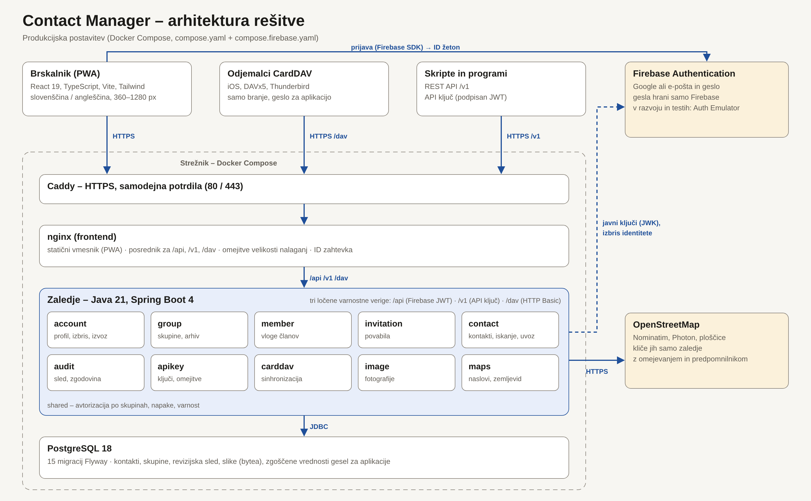

# Demo gradivo

Izmerjeno lokalno 26. 11. 2026 na `main` (`ff54dad`), brez sprememb aplikacije.

| Raven | Testi | Rezultat | Pokritost vrstic / vej |
|---|---|---|---|
| Zaledje – unit | 929 | zeleni | skupaj za zaledje (vse tri ravni): 96,1 % / 85,9 % |
| Zaledje – integracijski | 1663 | zeleni | |
| Zaledje – varnostni | 2450 | 0 padcev, 9 preskočenih | |
| Frontend – unit in UI | 1839 | zeleni | 95,8 % / 88,0 % |
| E2E (Playwright, celoten sistem) | 432 | zeleni | se ne meri |

Skupaj 7313 izvedb testov (7304 uspešnih, 9 preskočenih). E2E šteje vsako širino zaslona posebej.

## Vsebina

- `arhitektura.png` / `.svg` – arhitektura končane rešitve
- `postopek-kakovosti.png` / `.svg` – od zahteve (Spec Kit) do `main`
- `video/e2e-demo-skupaj.mp4` – testi sami klikajo po aplikaciji (upočasnjeno): povabilo, sočasno urejanje,
  množično urejanje 300 kontaktov, združevanje dvojnikov, povrnitev skupine; posamični posnetki so v isti mapi
- `porocilo-e2e/index.html` – poročilo Playwright za vseh 432 testov
- `pokritost-zaledje/index.html` (JaCoCo), `pokritost-frontend/index.html` (Vitest V8)
- `ujeta-napaka/` – namerno vnesena napaka in odziv testov

## Ujeta napaka

V `GroupAccess.require` smo začasno zahtevano najnižjo vlogo zamenjali z `VIEWER` (`napaka.diff`), tako da je
bralec smel pisati. `ContactIsolationMatrixSecurityIT` je padel v 4 od 107 primerov (pričakovano `403`, dobljeno
`201`, `200` oziroma `409`; `rdec-test.txt`). Po povrnitvi je zelenih vseh 107 (`zelen-test.txt`).

## Pregled kode z AI (primer, PR #21)

Podagent `pregled-testov` je našel 4 resne vrzeli; posledica sta bila tudi popravka v produkcijski kodi:
zavrnitev `<!DOCTYPE` v uvoženih preglednicah (XXE) in `404` namesto `403` pri CardDAV nad tujo skupino
(<https://github.com/ismarM/contact-manager-sdd/pull/21>).
